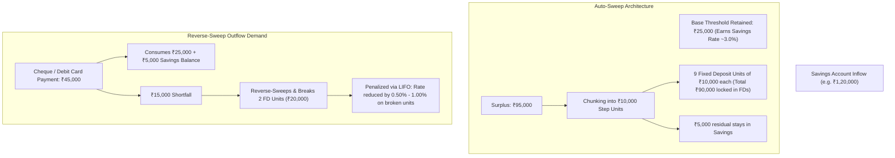

Many bank account holders view **Auto-Sweep** (marketed under names such as *MoneyMultiplier*, *Sweep-In*, *Flexi-Deposit*, or *Multi-Option Deposit - MOD*) as a pure "free lunch"—an automatic mechanism that elevates idle savings bank yields from 2.70%–3.00% up to 6.50%–7.25% fixed deposit rates while preserving instant ATM, UPI, and cheque liquidity.

While auto-sweep is a powerful cash-management instrument, its real-world net yield is routinely degraded by **breakage penalties**, **premature tenure step-downs**, and **tax inefficiencies**.

## 1. How Auto-Sweep Facilities Function

An auto-sweep facility bridges a depositor's primary transactional account (Savings or Current) with underlying short-term fixed deposit contracts. It operates through three core parameters:

1. **Threshold Limit:** The base cash balance that must remain in the savings account to support daily operations. Typical thresholds range from **₹25,000 to ₹1,00,000** depending on the bank and account variant.
2. **Sweep Step / Chunk Size:** The discrete unit amount in which surplus cash is moved. Typically **₹5,000, ₹10,000, or ₹25,000**. If your threshold is ₹25,000, your chunk size is ₹10,000, and your balance reaches ₹58,000, the bank will sweep exactly three ₹10,000 units (₹30,000) into FDs, leaving ₹28,000 in your savings account.
3. **Contracted FD Tenure:** Banks assign an automatic fixed tenure to swept units—most commonly **180 days, 365 days, or 390 days**—to capture higher headline interest rates.

## 2. Reverse-Sweep Mechanics & LIFO Order

When a payment (cheque clearing, UPI debit, EMI, credit card settlement) exceeds the balance in the primary savings account, the bank automatically triggers a **reverse-sweep** (sweep-in) to prevent transaction dishonor.

### LIFO vs FIFO Order of Liquidation:
Most major Indian commercial banks (including HDFC Bank, SBI, and ICICI Bank) deploy **LIFO (Last-In, First-Out)** order for breaking swept deposits:
- **LIFO Methodology:** The bank breaks the *most recently created* FD unit first. Because this newest deposit has accrued interest for the shortest duration, premature liquidation minimizes the total tenure-discount penalty incurred by the customer.
- **FIFO Methodology (Rare):** The oldest deposit is broken first. This disrupts mature deposits that were closest to completing their contracted high-interest tenure.

## 3. The Math of Premature Breakage Penalties

Under the **RBI Master Direction on Interest Rates on Deposits (2016)**, banks have discretion to prescribe premature withdrawal penal rates, provided they are transparently disclosed at deposit inception:

$$\text{Earned Rate on Broken FD} = \min\big(\text{Contracted Rate}, \text{Rate for Run Period}\big) - \text{Penalty}$$

Where the standard penal rate is typically **0.50% to 1.00%**.

### Worked Scenario: The 45-Day Breakage Trap

Suppose an account holder sweeps ₹1,00,000 into a 1-year FD contracted at **7.00% p.a.** 
After 45 days, an unexpected expense forces a reverse-sweep:

1. **Contracted Rate for 1 Year:** 7.00%
2. **Card Rate for 45 Days on Creation Date:** 4.50%
3. **Premature Breakage Penalty:** 0.50%
4. **Effective Interest Paid:** $4.50\% - 0.50\% = \mathbf{4.00\%}$

While 4.00% is still higher than the 3.00% base savings rate, the effective gain over 45 days on ₹1,00,000 is merely:

$$\Delta \text{Gain} = ₹1,00,000 \times \frac{4.00\% - 3.00\%}{365} \times 45 = \mathbf{₹123.28}$$

When transaction volumes and high monthly churn are introduced, continuous micro-breakages produce friction and operational complexity for negligible net rupee gains.

## 4. Key Rules for Maximizing Auto-Sweep Efficiency

| Strategic Parameter | Optimal Configuration | Rationale |
| :--- | :--- | :--- |
| **Threshold Calibration** | Set threshold equal to **1.5$\times$ average monthly outflows** | Prevents daily operational expenses from penetrating and breaking swept FD units. |
| **Chunk Step Size** | Choose small chunk sizes (**₹5,000 or ₹10,000**) | Ensures reverse sweeps break only the precise incremental amount required, preserving remaining FDs. |
| **Tenure Selection** | Choose 1-year tenure if rates are flat; 180 days if outflows are volatile | Minimizes the gap between contracted rate and actual run-period rate upon breakage. |
| **DICGC Aggregation Watch** | Sum savings balance + all swept FDs | Under DICGC rules, swept FDs are clubbed with the savings account under the "same capacity," capping total cover at ₹5,00,000. |
