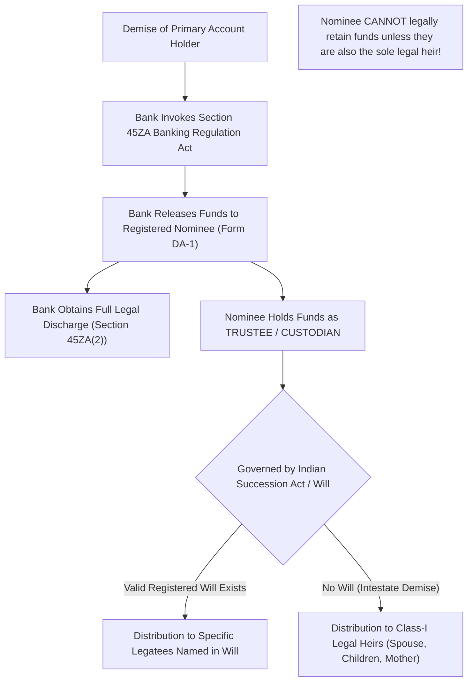

A pervasive and financially catastrophic belief among Indian bank depositors is that appointing a **Nominee** on a bank account, fixed deposit, or locker constitutes a valid legal bequest that transfers absolute ownership of the funds upon the depositor's demise.

Under Indian jurisprudence and the statutory provisions of the **Banking Regulation Act, 1949**, this belief is completely false. A nominee is legally defined not as an owner or legatee, but merely as a **fiduciary trustee and custodian** whose sole function is to receive the funds from the bank to give the bank a valid legal discharge.

## 1. Statutory Architecture: Section 45ZA to 45ZF

Nomination facilities in Indian banking are governed by **Sections 45ZA to 45ZF** of the Banking Regulation Act, 1949, enacted via the Banking Laws (Amendment) Act, 1983:
- **Form DA-1:** Prescribed statutory form for registering a nominee at account inception or during account lifecycle.
- **Form DA-2:** Prescribed statutory form for cancellation of an existing nomination.
- **Form DA-3:** Prescribed statutory form for variation or substitution of an existing nominee.

### Section 45ZA(2): The Bank's Immunity Shield
The statutory purpose of Section 45ZA is not to settle estate succession, but to protect the banking company from inter-familial inheritance litigation:
> *"Where a valid nomination is made, upon the death of the sole depositor or all depositors, the nominee shall be entitled to all rights of the sole depositor... and payment by the banking company to the nominee shall constitute a full discharge of its liabilities."*

Once the bank hands the fixed deposit proceeds or savings balance to the registered nominee, the bank is legally discharged from any liability. The dispute, if any, shifts entirely between the **nominee** and the **legal heirs**.

## 2. Landmark Supreme Court Precedents

The definitive legal status of a nominee was settled by the Supreme Court of India in the landmark constitutional authority of ***Sarbati Devi v. Usha Devi (AIR 1984 SC 346)***, and subsequently reaffirmed in ***Ram Chander Talwar v. Devender Kumar Talwar (2010 10 SCC 671)***:

1. **Nominee is a Fiduciary Bailee:** The Supreme Court held that nomination does not confer any beneficial interest on the nominee. The nominee merely receives the deposit as an agent or bailee on behalf of all the legal heirs of the deceased depositor.
2. **Succession Law Trumps Nomination:** The proceeds of the bank account form part of the deceased's estate. They are governed strictly by the **Indian Succession Act, 1925**, the **Hindu Succession Act, 1956**, or applicable personal religious inheritance statutes.
3. **Accountability of the Nominee:** If a father nominates his eldest son on an FD of ₹20 Lakhs, and dies intestate (without a will) leaving behind his widow, eldest son, and a daughter:
   - The bank will legally disburse the entire ₹20 Lakhs to the eldest son.
   - However, the widow and the daughter are entitled to demand their respective one-third statutory shares (Class-I legal heirs).
   - If the eldest son refuses to distribute the funds, he is liable for civil breach of trust and criminal misappropriation of estate assets.

## 3. Account Survivorship Mandates: E or S vs Former or Survivor

To ensure seamless liquidity for surviving family members without relying on probate or lengthy legal heir certifications, depositors should carefully configure account operating mandates:

| Operating Mandate | Authority During Lifetime | Operational Rights Upon Death of 1st Holder |
| :--- | :--- | :--- |
| **Either or Survivor (E or S)** | Either holder can operate independently, sign cheques, withdraw cash, or execute digital transfers. | The surviving joint holder automatically acquires full operational authority to operate or close the account immediately upon presenting death certificate. |
| **Former or Survivor (F or S)** | Only the "Former" (1st applicant) can operate the account during their lifetime. The "Survivor" has zero operational rights while 1st holder lives. | Operational rights transfer completely to the Survivor only upon the verified demise of the Former. |
| **Jointly (Joint Operations)** | Both holders must execute and sign every instruction, cheque, or closure jointly. | Account freezes upon death of either party; requires survivor plus all legal heirs of the deceased holder to claim proceeds. |

> [!TIP]
> **The Survivorship Golden Rule:** When an account is held jointly with a clear "Either or Survivor" survivorship clause, the mandate of survivorship takes precedence over nomination. The funds belong operationally to the surviving joint holder, bypassing immediate probate hurdles.
