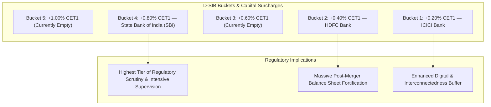

In the vocabulary of global and Indian central banking, no regulatory designation carries greater institutional weight than that of a **Domestic Systemically Important Bank (D-SIB)**. Popularly known as institutions that are **"Too Big to Fail" (TBTF)**, D-SIBs are banks whose distress or disorderly failure would cause catastrophic disruption to the domestic real economy and financial system.

To counteract the moral hazard inherent in this implicit sovereign backstop, the Reserve Bank of India mandates that D-SIBs hold significantly higher equity capital buffers than ordinary commercial banks.

## 1. The D-SIB Assessment Methodology

The RBI released its initial Framework for Dealing with Domestic Systemically Important Banks in July 2014, adhering to principles established by the Basel Committee on Banking Supervision (BCBS).

The assessment is conducted annually using balance sheet data as of March 31. Banks are evaluated across four primary quantitative parameters:

| Indicator / Dimension | Parameter Weight | Underlying Economic Measurement |
| :--- | :--- | :--- |
| **Size** | **33.33%** | Total exposures (on-balance sheet assets + off-balance sheet items) as a % of Indian GDP. Banks with size exceeding 2% of GDP are placed in the sample. |
| **Interconnectedness** | **16.66%** | Intra-financial system assets, intra-financial system liabilities, and wholesale inter-bank funding. Measures contagion potential. |
| **Substitutability** | **16.66%** | Assets under custody, clearing and settlement activities, and underwriting volume. Reflects whether the market could absorb sudden failure. |
| **Complexity** | **33.33%** | Notional amount of OTC derivatives, trading and available-for-sale securities, and cross-jurisdictional claims. |

## 2. Current D-SIB Buckets and Additional CET1 Surcharges

Based on systemic importance scores calculated by the central bank, banks are assigned to one of five buckets. Each bucket requires an additional **Common Equity Tier 1 (CET1)** capital requirement expressed as a percentage of Risk-Weighted Assets (RWAs):

| D-SIB Bucket | Bank Name | Additional CET1 Surcharge (% of RWAs) | Effective Minimum Total Capital (including CCB) |
| :--- | :--- | :--- | :--- |
| **Bucket 5** | *None* | + 1.00% | 12.50% |
| **Bucket 4** | **State Bank of India (SBI)** | **+ 0.80%** | **12.30%** |
| **Bucket 3** | *None* | + 0.60% | 12.10% |
| **Bucket 2** | **HDFC Bank** | **+ 0.40%** | **11.90%** |
| **Bucket 1** | **ICICI Bank** | **+ 0.20%** | **11.70%** |

*(Standard Basel III baseline in India requires 5.5% minimum CET1 + 2.5% Capital Conservation Buffer + 3.5% Additional Tier 1 & Tier 2 = 11.50% total CRAR).*

### The SBI and HDFC Bank Surcharge Escalation
Following the colossal amalgamation of Housing Development Finance Corporation (HDFC Ltd) into HDFC Bank in July 2023, HDFC Bank's balance sheet swelled past ₹36 Lakh Crore, triggering a higher systemic score that elevated it to **Bucket 2 (0.40%)**. Concurrently, SBI's sustained loan book expansion elevated it to **Bucket 4 (0.80%)**.

## 3. What "Too Big to Fail" Means for Operating Cash

For corporate treasuries, family offices, and high-net-worth depositors managing operating cash balances far exceeding the ₹5,00,000 DICGC insurance cap, D-SIBs provide a structural advantage:

1. **Implicit Sovereign Backstop:** While the DICGC insurance limit is legally identical (₹5 Lakhs) across all banks, the sovereign cannot permit an orderly liquidation of an institution holding 20% of the national banking asset base without triggering systemic economic gridlock.
2. **Resolution Mechanics (Prompt Amalgamation):** If a D-SIB faces stress, historical Indian banking precedent (Global Trust Bank into Orient Bank of Commerce in 2004, Yes Bank reconstruction in 2020) demonstrates that the RBI and Ministry of Finance orchestrate capital injections or forced institutional amalgamations, avoiding depositor haircuts.
3. **Liquidity Coverage Ratio (LCR) Discipline:** D-SIBs maintain daily LCRs consistently exceeding 120% to 140% in high-quality liquid assets (Government of India securities and central bank reserves).

> [!TIP]
> **Treasury Rule of Thumb:** Operating cash required for payroll, statutory tax remittances (GST, TDS, Advance Tax), and clearing should be concentrated in D-SIBs to insulate business operations from idiosyncratic banking runs.
