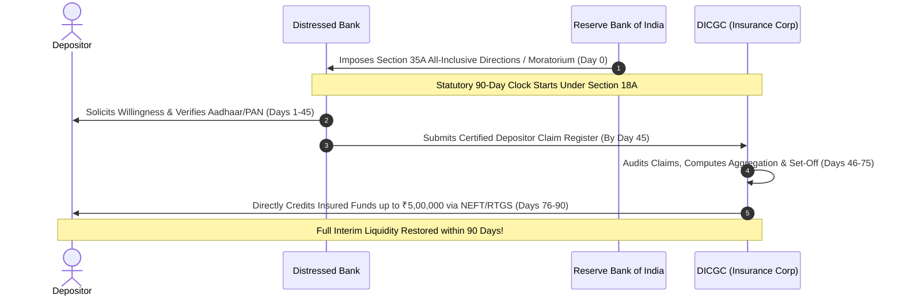

Prior to September 1, 2021, when the Reserve Bank of India placed a troubled commercial or cooperative bank under regulatory freeze ("All-Inclusive Directions" under Section 35A of the Banking Regulation Act, 1949), depositors entered a protracted legal purgatory. 

Even though the law guaranteed deposit insurance up to ₹5 Lakhs, that insurance payout was statutorily contingent on the bank being **formally liquidated** or an amalgamation scheme being finalized—a legal process that routinely took between **8 to 12 years** across Indian courts and insolvency tribunals.

The enactment of the **Deposit Insurance and Credit Guarantee Corporation (Amendment) Act, 2021** revolutionized this paradigm by inserting **Section 18A** into the parent Act.

## 1. The Statutory Trigger: Section 18A(1)

Under **Section 18A(1)**, the liability of the DICGC to make interim payments to depositors is triggered whenever an insured bank is subject to any order, instruction, or direction by the RBI:
- Prohibiting the bank from making payments to depositors;
- Restricting withdrawal amounts to nominal figures (e.g., ₹1,000 or ₹10,000);
- Imposing a formal moratorium under Section 45 of the Banking Regulation Act, 1949.

Depositors no longer have to wait for the death and burial (liquidation) of the bank. The mere statutory freezing of withdrawals activates the Corporation's payout mandate.

## 2. The Strict 90-Day Timeline Breakdown

Parliament designed Section 18A with explicit, non-discretionary deadlines divided into three chronological operational phases:

### Phase 1: Days 1 to 45 (Bank's Obligation)
- Within **45 days** from the date the RBI imposes restrictions, the stressed bank must compile a comprehensive list of all outstanding deposits and credit liabilities.
- The bank must obtain the **willingness** of depositors to receive their insurance payout and verify customer identity details (Aadhaar, PAN, active alternate bank account).
- The bank submits the certified claim list electronically to the DICGC portal.

### Phase 2: Days 46 to 75 (DICGC Verification)
- Within **30 days** of receiving the certified list from the bank, DICGC undertakes forensic verification.
- The Corporation applies the "Same Right and Capacity" aggregation rules across all accounts of each depositor.
- It deducts any outstanding loans or credit lines owed by the depositor to the bank (statutory set-off under Section 17).
- It finalizes the net insured amount (capped at ₹5,00,000).

### Phase 3: Days 76 to 90 (Direct Disbursement)
- Within **15 days** after completing verification, DICGC releases the funds directly to depositors.
- Payments are made via automated electronic clearing (NEFT/RTGS) directly into the alternate, healthy bank accounts designated by the depositors.

$$\text{Total Maximum Elapsed Time} = 45\text{ days} + 30\text{ days} + 15\text{ days} = \mathbf{90\text{ Days}}$$

## 3. Statutory Exceptions: The 90-Day Extension Provision

Under **Section 18A(2)**, there is a narrow exception where the 90-day window can be extended:
- If the RBI is actively structuring a formal **Scheme of Compromise, Arrangement, Amalgamation, or Reconstruction** (as was executed during the Yes Bank rescue in 2020), the RBI may request DICGC to pause disbursements for an additional period not exceeding **90 days**.
- Even in such scenarios, the absolute outer limit for depositors to receive liquidity cannot exceed **180 days**.

## 4. Subrogation and Post-Payout Priority

When DICGC disburses the interim payment to a depositor under Section 18A:
1. **Legal Subrogation (Section 21):** To the extent of the insurance money paid (e.g. ₹5,00,000), DICGC steps into the depositor's shoes and becomes a priority creditor against the bank's assets.
2. **Residual Claims of the Depositor:** If the depositor had ₹8,00,000 in the bank, they receive ₹5,00,000 from DICGC. The remaining ₹3,00,000 remains registered as an unsecured depositor claim. If the liquidator subsequently recovers money through asset recovery, the depositor ranks for dividends according to the statutory distribution waterfall.

> [!NOTE]
> Section 18A proved decisively effective during the resolution of numerous urban cooperative banks in Maharashtra, Gujarat, and Punjab between 2021 and 2025, where over 95% of retail depositors received their entire savings within the mandated 90-day boundary.
