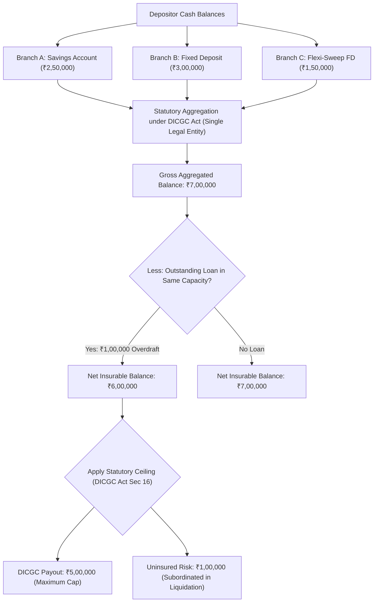

The **Deposit Insurance and Credit Guarantee Corporation (DICGC)**, a wholly owned subsidiary of the Reserve Bank of India, is the sole statutory entity empowered by Parliament under the **DICGC Act, 1961** to provide deposit insurance in the Republic of India.

Understanding the precise mathematical and statutory contours of DICGC coverage is essential for any individual or corporate entity holding cash balances in Indian banks.

## 1. The Statutory Insurance Ceiling: ₹5,00,000

Under **Section 16(1)** of the DICGC Act, 1961 (as amended with effect from February 4, 2020), the maximum liability of the Corporation for each depositor in an insured bank is **₹5,00,000 (Five Lakh Rupees)**.

### Crucial Statutory Mechanics:
1. **Principal and Accrued Interest Combined:** The ₹5 Lakh ceiling does **not** apply separately to principal and interest. If an individual holds an FD of ₹4,80,000 and has accrued ₹45,000 in interest up to the date of cancellation of the bank's license or imposition of moratorium, the total claim is ₹5,25,000. DICGC will disburse exactly **₹5,00,000**, leaving the remaining ₹25,000 as an unsecured claim against the official liquidator.
2. **Single Legal Entity Rule (All Branches Clubbed):** A scheduled commercial or cooperative bank constitutes a single corporate legal entity under Indian company and banking law. Opening accounts in different branches (e.g., Branch A in Bengaluru, Branch B in Mumbai, Branch C in New Delhi) does **not** create separate insurance covers. All accounts across all branches nationwide are summed together.
3. **All Deposit Types Aggregated:** The aggregation covers:
   - Savings Bank accounts
   - Current accounts
   - Fixed Deposits (FDs)
   - Recurring Deposits (RDs)
   - Auto-sweep term deposit units

## 2. Right of Set-Off: Mandatory Loan Adjustment

Under **Section 17(1)** of the DICGC Act, 1961, the Corporation has the legal mandate to deduct any outstanding dues owed by the depositor to the same bank before calculating the insurable payout.

$$\text{Net Insurable Balance} = \max\Big(0, \sum \text{Deposits} - \sum \text{Liabilities in Same Capacity}\Big)$$

$$\text{DICGC Disbursement} = \min\Big(₹5,00,000, \text{Net Insurable Balance}\Big)$$

### Worked Quantitative Example:

| Account / Facility | Nature of Holding | Balance / Outstanding |
| :--- | :--- | :--- |
| Savings Account | Personal Asset | + ₹1,50,000 |
| Fixed Deposit | Personal Asset | + ₹4,50,000 |
| Auto-Sweep FD | Personal Asset | + ₹1,00,000 |
| **Gross Personal Assets** | **Total Deposits** | **+ ₹7,00,000** |
| Personal Loan Outstanding | Liability at same bank | - ₹2,50,000 |
| **Net Balance after Set-Off** | **Insurable Claim** | **₹4,50,000** |
| **DICGC Insurance Payout** | **Disbursed within 90 days** | **₹4,50,000 (100% of Net)** |

Because the net balance after statutory set-off (₹4,50,000) is below the statutory ceiling of ₹5,00,000, the depositor suffers zero capital impairment.

## 3. What Deposits Are Excluded from DICGC Insurance?

Under **Section 2(g)** of the DICGC Act, 1961, the following deposit categories are strictly excluded from insurance protection:

1. **Foreign Government Deposits:** Deposits of foreign governments.
2. **Central / State Government Deposits:** Balances held by Central and State Governments.
3. **Inter-Bank Deposits:** Monies deposited by one commercial or cooperative bank with another bank.
4. **State Land Development Banks:** Deposits held by State Land Development Banks with State Cooperative Banks.
5. **Deposits Received Outside India:** Any amount received by a bank outside India (e.g. overseas foreign branches).
6. **Non-Banking Instruments:** Commercial paper, certificates of deposit (CDs), subordinated debt, and bonds issued by banks are securities, not deposits, and carry zero DICGC cover.

## 4. Multi-Bank Architecture: The Sovereign Firewall

Because DICGC protection applies **per depositor per bank**, an investor or treasury manager holding ₹20,00,000 in liquid capital can achieve 100% statutory deposit insurance by distributing ₹5,00,000 across four separate Scheduled Commercial Banks:

| Institution | Depositor Holding | DICGC Cap | Uninsured Exposure |
| :--- | :--- | :--- | :--- |
| State Bank of India | ₹5,00,000 | ₹5,00,000 | ₹0 |
| HDFC Bank | ₹5,00,000 | ₹5,00,000 | ₹0 |
| ICICI Bank | ₹5,00,000 | ₹5,00,000 | ₹0 |
| Bank of Baroda | ₹5,00,000 | ₹5,00,000 | ₹0 |
| **Total Portfolio** | **₹20,00,000** | **₹20,00,000** | **₹0 (100% Protected)** |

By contrasting this distributed architecture against parking ₹20 Lakhs in a single bank (where ₹15 Lakhs remains at risk during liquidation), depositors eliminate idiosyncratic institutional credit risk without sacrificing liquidity.
