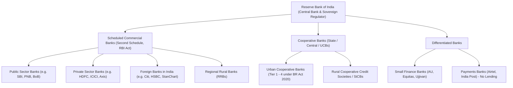

The Indian banking ecosystem is not a homogeneous terrain where every institution labeled a "bank" carries identical institutional solvency, regulatory oversight, or resolution mechanisms. For depositors, corporate treasurers, and individuals parking operating cash, understanding the legal classification of an institution under the **Reserve Bank of India (RBI) Act, 1934** and the **Banking Regulation Act, 1949** is the first line of defense against counterparty capital impairment.



## 1. The Second Schedule of the RBI Act, 1934

To be categorized as a **Scheduled Commercial Bank (SCB)**, an institution must satisfy strict statutory thresholds defined under **Section 42(6)(a)** of the Reserve Bank of India Act, 1934:
1. **Paid-up Capital & Reserves:** The bank must maintain paid-up capital and reserves of an aggregate value not less than ₹5 Lakhs (modern licensing requires hundreds of crores under current RBI on-tap licensing guidelines).
2. **Affairs Conduct Mandate:** It must satisfy the RBI that its affairs are not being conducted in a manner detrimental to the interests of its depositors.
3. **Statutory Liquidity Privileges:** Inclusion in the Second Schedule confers automatic access to RBI liquidity facilities, including the Liquidity Adjustment Facility (LAF), repo windows, Marginal Standing Facility (MSF), and eligibility to act as an authorized dealer in foreign exchange and government securities.

### Scheduled Commercial Banks: Three Pillars

| Parameter | Public Sector Banks (PSBs) | Private Sector Banks | Foreign Banks (WOS / Branches) |
| :--- | :--- | :--- | :--- |
| **Sovereign Backing** | Majority owned (51%+) by President of India | Private institutional & retail shareholders | Foreign parent banking group |
| **Systemic Risk Status** | State Bank of India (D-SIB Bucket 4) | HDFC Bank (Bucket 2), ICICI Bank (Bucket 1) | Governed by Basel III & RBI branch rules |
| **Minimum CRAR (Basel III)** | 11.5% (including CCB 2.5%) | 11.5% (including CCB 2.5%) | 11.5% (plus branch capital limits) |
| **DICGC Coverage** | Mandatorily covered up to ₹5,00,000 | Mandatorily covered up to ₹5,00,000 | Mandatorily covered up to ₹5,00,000 |
| **Priority Sector Lending (PSL)** | 40% of ANBC | 40% of ANBC | 40% of ANBC (for 20+ branches) |

## 2. Cooperative Banks: The Dual-Regulation Dilemma

Historically, **Urban Cooperative Banks (UCBs)** operated under a split regulatory regime:
- **Banking Operations:** Supervised by the RBI (licensing, branch expansion, capital adequacy).
- **Administrative & Governance:** Controlled by the Registrar of Cooperative Societies (RCS) of the respective State Government or Central Registrar for Multi-State Cooperative Banks.

This dual-control model contributed to well-documented corporate governance failures, political lending concentrations, and delayed resolution during financial distress (e.g., Punjab and Maharashtra Cooperative Bank in 2019).

### The Banking Regulation (Amendment) Act, 2020
To close these loopholes, Parliament passed the **Banking Regulation (Amendment) Act, 2020**, empowering the RBI to:
1. Supersede boards of directors of cooperative banks without prior State RCS concurrence.
2. Formulate schemes for amalgamation, restructuring, or reconstruction without placing the bank under a debilitating moratorium.
3. Enforce qualifications for directors, audit committees, and appointment of Managing Directors.

### RBI's 4-Tier Supervisory Architecture for UCBs (2022 Framework)
The RBI introduced a four-tiered regulatory matrix based on deposit size to enforce graded capital adequacy and risk management:

```
Tier 1: Deposits up to ₹100 Crore (Minimum CRAR 9%)
Tier 2: Deposits ₹100 Crore to ₹1,000 Crore (Minimum CRAR 12%)
Tier 3: Deposits ₹1,000 Crore to ₹10,000 Crore (Minimum CRAR 12%)
Tier 4: Deposits above ₹10,000 Crore (Minimum CRAR 12%, full compliance with Basel-like standards)
```

## 3. Small Finance Banks (SFBs): Niche Mandates with Full Commercial Power

Small Finance Banks were introduced by the RBI in 2014 to promote financial inclusion for small business units, micro and small industries, unorganized sector entities, and small/marginal farmers.

### Mandatory Prudential Constraints on SFBs
Unlike universal commercial banks, SFBs operate under statutory lending curbs designed to limit systemic risk:
- **75% Priority Sector Lending:** SFBs must allocate at least 75% of their Adjusted Net Bank Credit (ANBC) to priority sectors (vs 40% for universal banks).
- **50% Ticket-Size Restriction:** At least 50% of an SFB's loan portfolio must comprise loans and advances of ticket size up to ₹25 Lakhs.
- **Minimum CRAR:** SFBs must maintain a minimum capital adequacy ratio of 15% on an ongoing basis (higher than the 11.5% required for universal banks).

> [!IMPORTANT]
> **Equal Statutory Deposit Protection:** Every rupee deposited in a licensed Small Finance Bank enjoys identical statutory DICGC protection up to ₹5,00,000 per depositor as an account in the State Bank of India or HDFC Bank. However, operational recovery speeds during resolution depend on institutional solvency and market liquidity.

## 4. Institutional Cash Allocation Heuristics

When designing a corporate or personal operating cash architecture across these institutional tiers:

1. **Intraday Clearing & Core Payroll:** Allocate strictly to **Domestic Systemically Important Banks (D-SIBs)**—SBI, HDFC Bank, ICICI Bank—where systemic bailout risk is virtually zero.
2. **Working Capital Surplus (Up to ₹5 Lakhs per Bank):** Leverage higher term-deposit yields at Tier-1 Small Finance Banks or Scheduled Private Banks, ensuring the total balance (principal + accrued interest) never breaches ₹5,00,000 per unique legal capacity.
3. **Avoid Unscheduled / Small Cooperative Institutions:** Unless guaranteed by explicit corporate liens, never park non-insured surplus cash in Tier-1/Tier-2 UCBs due to governance opacity and lower capital buffers.
