Across the Indian banking landscape, tens of thousands of crores of rupees sit idle in forgotten savings accounts, matured fixed deposits, and unpaid dividend warrants. Under statutory directions issued by the Reserve Bank of India, bank accounts do not simply evaporate when neglected; they progress through a legally mandated transition from **Active** to **Inoperative**, and eventually to **Unclaimed Deposits** transferred to the central bank.

```mermaid
stateDiagram-v2
    [*] --> ActiveAccount: Regular Customer-Induced Transactions
    
    ActiveAccount --> Inoperative: No Customer Transaction for > 2 Years
    note right of Inoperative: Debit/Credit Operations Frozen; No Penal Charges Permitted
    
    Inoperative --> ActiveAccount: Re-KYC Completed (Aadhaar / Biometric / In-Person)
    
    Inoperative --> DEAFund: No Claim or Operation for > 10 Continuous Years
    note right of DEAFund: Transferred to RBI DEA Fund under Section 26A
    
    DEAFund --> Reclaimed: Identified via RBI UDGAM Portal & Reclaimed with Interest!
```

## 1. The Statutory Definition of Inoperative Accounts

Under the **RBI Master Direction on Inoperative Accounts (2024)**:
- A savings or current bank account is classified as **Inoperative (or Dormant)** if there have been **no customer-induced transactions** for a continuous period of **more than two years**.

### What Constitutes a "Customer-Induced" Transaction?
To prevent an account from slipping into inoperative status, transactions must be initiated by the customer or an authorized third party:
- **Valid Customer Transactions:** Cash deposit/withdrawal, ATM transaction, cheque clearance, UPI transfer, NEFT/RTGS debit/credit, internet banking login with transaction, or dividend credit.
- **Transactions That Do NOT Prevent Dormancy:** System-generated entries—such as quarterly interest credits applied by the bank or periodic debit card AMC deductions—do **not** count as customer-induced transactions.

### Statutory Consumer Protections While Inoperative:
1. **Ban on Inactivity Penalties:** The RBI explicitly prohibits banks from levying penal charges on inoperative accounts for non-maintenance of minimum average balances (MAB).
2. **Continued Interest Accrual:** Banks are statutorily required to continue crediting savings account interest into inoperative accounts on a regular quarterly basis.
3. **Zero Activation Fee:** Banks cannot charge a fee for reactivating an inoperative account.

## 2. The 10-Year Unclaimed Threshold & The DEA Fund

Under **Section 26A** of the Banking Regulation Act, 1949, Parliament created the **Depositor Education and Awareness (DEA) Fund**:
- Any deposit balance in an account that has remained inoperative or unclaimed for **10 years or more**, or any fixed deposit that has remained unclaimed for 10 years after its maturity date, must be transferred by the banking institution to the RBI's DEA Fund on a monthly basis.
- The principal amount, along with statutory interest prescribed by the RBI from time to time, continues to be held in trust by the central bank.

## 3. The UDGAM Portal: Centralized Reclamation Gateway

To empower citizens and legal heirs to locate and reclaim forgotten balances scattered across multiple banking institutions, the RBI launched the **UDGAM (Unclaimed Deposits – Gateway to Access inforMation)** portal (`udgam.rbi.org.in`).

### How UDGAM Resolves Unclaimed Balances:
1. **Centralized Query Engine:** Allows a user to search across all public sector banks, major private banks, foreign banks, and cooperative banks simultaneously.
2. **Search Criteria:** Search can be initiated using either:
   - Account holder's Name and PAN number;
   - Account holder's Name and Voter ID / Passport / Driving Licence;
   - Account holder's Name and registered residential address.
3. **Reclamation Procedure:**
   - Once an unclaimed account is located via UDGAM, the account holder or legal heir approaches the respective bank branch with the UDGAM Unclaimed Deposit Reference Number (UDRN).
   - The claimant submits fresh KYC documents (Aadhaar, PAN, proof of address) and a specimen signature.
   - For deceased holders, legal heirs submit death certificates, legal heirship certificates/succession certificates, and registered Form DA-1 nomination documentation.
   - The bank verifies records, claims the refund from the RBI DEA Fund, and credits the principal plus statutory accrued interest directly to the claimant.
