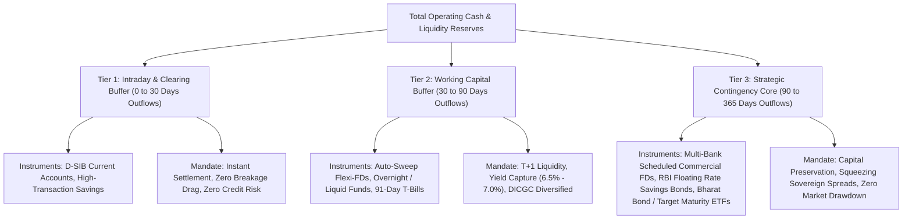

Cash is the oxygen of solvency. Yet in treasury management—whether for a high-growth tech startup, an MSME enterprise, a family office, or a financially disciplined household—cash allocation is frequently handled with binary extremism: either all cash is left idling in a zero/low-interest checking account, or capital is excessively locked in illiquid, high-yield credit instruments where a sudden liquidity crunch forces distressed fire-sales.

By adapting the institutional principles of the **Basel III Liquidity Coverage Ratio (LCR)** framework, cash managers can construct a robust **Three-Tier Operating Cash Architecture**.

## 1. The Basel III LCR Foundation

Under RBI Master Directions on Liquidity Standards, commercial banks are mandated to maintain an unencumbered pool of **High-Quality Liquid Assets (HQLA)** that can be converted into cash instantly to meet a 30-day stressed liquidity outflow scenario:

$$\text{LCR} = \frac{\text{Stock of High-Quality Liquid Assets (HQLA)}}{\text{Total Net Cash Outflows over 30 Days}} \ge 100\%$$

Translating this regulatory standard to corporate and personal balance sheets provides a systematic methodology for dividing operating capital into three non-correlated liquidity tranches.

## 2. The Three-Tier Architecture Defined

### Tier 1: Intraday Clearing & Immediate Commitments (0 to 30 Days)
- **Time Horizon:** 0 to 30 calendar days.
- **Capital Quantum:** **1.0$\times$ to 1.5$\times$** of monthly non-discretionary commitments (payroll, statutory dues like GST, TDS, advance tax, vendor AP, EMIs).
- **Approved Banking Instruments:** Current Accounts or premier Savings Accounts maintained exclusively at **Domestic Systemically Important Banks (SBI, HDFC Bank, ICICI Bank)**.
- **Core Philosophy:** Yield optimization in Tier 1 is entirely secondary to operational reliability. High UPI/RTGS throughput, zero maintenance friction, and zero counterparty failure risk take absolute precedence.

### Tier 2: Working Capital & Operational Buffer (30 to 90 Days)
- **Time Horizon:** 30 to 90 calendar days.
- **Capital Quantum:** **2.0$\times$ to 3.0$\times$** of monthly operational burn.
- **Approved Banking Instruments:**
  - Auto-Sweep Flexi-Deposits with well-calibrated thresholds.
  - 91-Day Government of India Treasury Bills (purchased direct via RBI Retail Direct with 0% credit risk).
  - High-quality Liquid Mutual Funds / Overnight Funds holding sovereign paper.
- **Core Philosophy:** Earning near-repo or short-term yield curves while retaining T+0 to T+1 liquidation speed. If held in bank deposits, balances must be diversified to stay under the ₹5,00,000 DICGC insurance cap per institution.

### Tier 3: Strategic Contingency Core (90 to 365 Days)
- **Time Horizon:** 3 months to 12 months.
- **Capital Quantum:** Balance of emergency reserves and capital earmarked for future CapEx or tax disbursements.
- **Approved Banking Instruments:**
  - 1-Year to 2-Year Fixed Deposits laddered across top-tier Scheduled Commercial Banks and premier Small Finance Banks.
  - RBI Floating Rate Savings Bonds (FRSBs) backed by the sovereign.
  - AAA-rated corporate fixed deposits (strictly restricted to sovereign NBFCs like Bajaj Finance or HDFC Credila).
- **Core Philosophy:** Maximizing compounding returns with guaranteed nominal capital recovery. Zero equity market volatility, zero duration drawdowns.

## 3. Dynamic Rebalancing & Reconstitution Rules

A cash architecture is only as resilient as its rebalancing discipline:
1. **The Inflow Cascade:** All enterprise revenue and personal income lands first in Tier 1. Once Tier 1 reaches its target (1.5$\times$ monthly burn), excess liquidity automatically cascades down into Tier 2.
2. **The Outflow Replenishment:** As monthly operational expenses deplete Tier 1, Tier 2 units are liquidated in an orderly fashion (using LIFO or maturing T-Bills) to reconstitute the Tier 1 buffer.
3. **Emergency Drawdown Protocol:** Tier 3 capital is strictly quarantined. It requires dual-authorization or formal personal review to break, preventing impulse deployment into speculative investments or lifestyle creep.

By maintaining this structured firewall, treasuries achieve institutional liquidity resilience, immunizing operations from banking sector freezes and economic turbulence.
