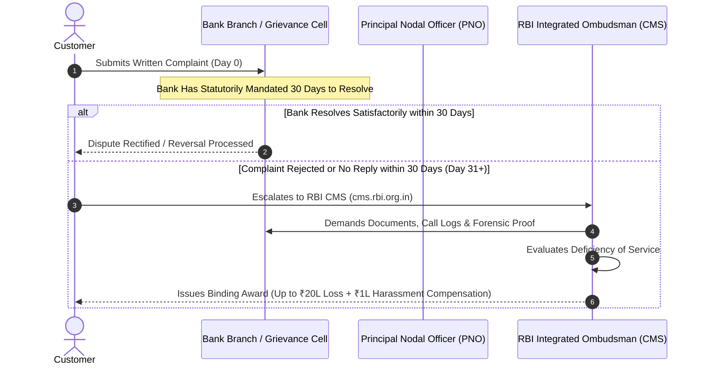

When an Indian commercial, cooperative, or small finance bank fails to address an unauthorized debit, wrongfully dishonors a cheque, delays an auto-sweep reversal, or miscalculates interest penalties, depositors possess a formal, legally enforceable quasi-judicial mechanism: the **Reserve Bank - Integrated Ombudsman Scheme, 2021 (RB-IOS 2021)**.

Launched on November 12, 2021, the Integrated Ombudsman Scheme subsumed the erstwhile Banking Ombudsman Scheme (2006), the Ombudsman Scheme for NBFCs (2018), and the Ombudsman Scheme for Digital Transactions (2019) into a single, unified national framework operating under the doctrine of **"One Nation, One Ombudsman."**

## 1. The Statutory Prerequisite: The 30-Day Window

A depositor **cannot** approach the RBI Ombudsman on Day 1 of a dispute. Under **Clause 10(1)** of RB-IOS 2021, a complaint is maintainable before the Ombudsman only if:
1. The complainant had initially submitted a formal written or electronic grievance to the regulated entity (the bank); AND
2. The bank rejected the complaint wholly or partly; OR
3. The complainant did not receive any reply within **30 calendar days** from the date of lodging the complaint; OR
4. The complainant is dissatisfied with the resolution offered by the bank.

Furthermore, the complaint must be lodged before the Ombudsman within **one year** after the expiry of the 30-day response period.

## 2. Jurisdiction & "Deficiency of Service"

Unlike earlier schemes that listed an exhaustive, rigid inventory of grounds, the RB-IOS 2021 defines jurisdiction broadly under the single umbrella term: **"Deficiency in Service"**.
> *"Deficiency in service means a shortcoming or an inadequacy in any financial service, which the regulated entity is required to provide according to statutory provisions, contractual terms, or RBI directions."*

### Common Grounds for Ombudsman Awards:
- Non-adherence to RBI directions on unauthorized electronic transactions (failure to provide 10-day shadow credit);
- Delays or refusals in closing bank accounts or releasing mature fixed deposit proceeds;
- Inaccurate reporting to Credit Information Companies (CIBIL, Experian, CRIF High Mark);
- Wrongful levy of minimum balance charges or auto-sweep premature breakage penalties;
- Refusal to accept cash deposits or legitimate RBI sovereign currency notes;
- Delays in executing nominee settlement claims following death of the primary holder.

## 3. Award Powers & Financial Compensation Limits

Under **Clause 15** of the Scheme, the RBI Ombudsman holds substantial quasi-judicial powers to order restitution and penal damages:

| Parameter | Statutory Monetary Limit | Nature of Compensation |
| :--- | :--- | :--- |
| **Direct Consequential Loss** | **Up to ₹20,00,000 (Twenty Lakhs)** | Reversal of direct financial loss suffered by the complainant due to the bank's action or omission. |
| **Mental Harassment & Anguish** | **Up to ₹1,00,000 (One Lakh)** | Discretionary compensation for loss of time, expenses incurred, and emotional distress caused to the complainant. |
| **Credit Facility Grievances** | Actual verified impairment | Restoration of damaged credit score and cancellation of erroneous penalty entries. |

## 4. How to File an Escalation via the CMS Portal

1. **Access the Central Portal:** Visit `cms.rbi.org.in` or dispatch a physical letter to the Centralised Receipt and Processing Centre (CRPC) at RBI, Chandigarh.
2. **Submit Audit Evidence:** Attach:
   - Copy of original complaint filed with the bank branch or Nodal Officer;
   - Bank's acknowledgment or rejection letter showing transaction date and ticket reference;
   - Account statement highlighting the disputed debit or incorrect charge;
   - Proof that 30 calendar days have elapsed since initial submission.
3. **Appellate Authority:** If either the customer or the bank is dissatisfied with the Ombudsman's final Award, an appeal may be filed within 30 days before the Executive Director in-charge of the Consumer Education and Protection Department at the Reserve Bank of India.
