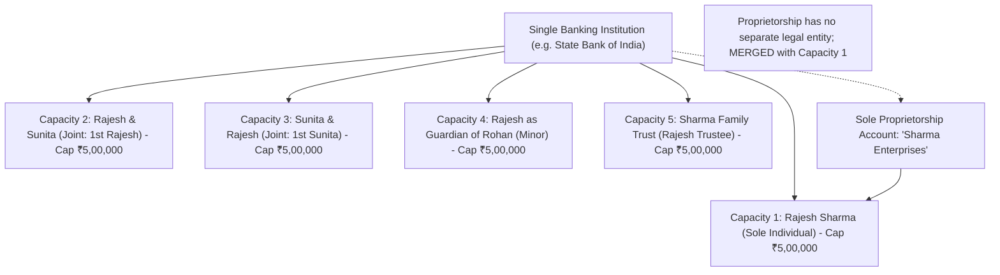

The most common misconception among bank depositors in India is that an individual cannot hold more than ₹5,00,000 of insured deposits within a single banking institution. Under the governing legal architecture of the **Deposit Insurance and Credit Guarantee Corporation Act, 1961**, this premise is inaccurate.

Deposit insurance in India is administered on the basis of **"Same Right and Same Capacity."** When funds are held in legally distinct capacities or rights within the exact same bank, each separate capacity commands an independent **₹5,00,000** statutory insurance limit.



## 1. What Constitutes "Same Capacity"? (The Aggregation Trap)

All accounts held by a person where the legal identity, ownership interest, and beneficial enjoyment are identical are treated as held in the **same right and capacity**.

### Accounts That Are Mandatorily Aggregated:
1. **Multiple Individual Accounts:** A savings account, fixed deposit, recurring deposit, and tax-saver FD in your name across one or ten branches of the same bank are clubbed into a single ₹5 Lakh bucket.
2. **Sole Proprietorship Accounts:** Under Indian commercial law, a sole proprietorship is **not** a distinct juridical person. It is merely a trade name under which an individual does business. Therefore:
   $$\text{Balance}(\text{Individual Savings}) + \text{Balance}(\text{Proprietorship Current A/c}) \implies \text{Single ₹5,00,000 Limit}$$
   If Rajesh has ₹3,00,000 in personal savings and ₹4,00,000 in his proprietorship firm "Rajesh Logistics" at Axis Bank, his total claim is ₹7,00,000. In bank liquidation, DICGC pays ₹5,00,000; the remaining ₹2,00,000 is unprotected.
3. **Partner's Personal Account vs Joint Accounts with Third Parties:** Addressed under distinct capacity rules.

## 2. What Constitutes "Different Right and Capacity"?

Under DICGC statutory guidelines, accounts held in the following capacities are legally autonomous and each qualify for a separate ₹5,00,000 cover within the **same bank**:

### Matrix of Independent Insurance Capacities:

| Account Holder Configuration | Legal Right & Capacity | DICGC Insurance Ceiling | Aggregated With Other Personal Accounts? |
| :--- | :--- | :--- | :--- |
| **Rajesh Sharma** | Individual Personal Capacity | ₹5,00,000 | Yes (all personal FDs, RDs, Savings, Proprietorships) |
| **Rajesh Sharma & Sunita Sharma** | Joint Capacity (Rajesh as 1st Applicant) | ₹5,00,000 | **No.** Distinct joint bucket. |
| **Sunita Sharma & Rajesh Sharma** | Joint Capacity (Sunita as 1st Applicant) | ₹5,00,000 | **No.** Order of names changes the primary legal ownership. |
| **Rajesh Sharma & Amit Sharma** | Joint Capacity with different co-holder | ₹5,00,000 | **No.** Distinct joint legal partnership. |
| **Rajesh Sharma (Guardian for Minor Rohan)** | Fiduciary / Guardian Capacity | ₹5,00,000 | **No.** Beneficial owner is the minor under Hindu Minority & Guardianship Act. |
| **Sharma Family Trust (Rajesh Trustee)** | Registered Trust Capacity | ₹5,00,000 | **No.** Governed by Indian Trusts Act, 1882. |
| **M/s Sharma & Sons (Partnership Firm)** | Registered Partnership Capacity | ₹5,00,000 | **No.** Distinct firm entity under Indian Partnership Act, 1932. |
| **Sharma Tech Pvt Ltd** | Private Limited Corporate Entity | ₹5,00,000 | **No.** Independent corporate legal person under Companies Act, 2013. |

## 3. Case Study: Structuring ₹25,00,000 Safely Within One Bank

Consider a family unit consisting of Rajesh (husband) and Sunita (wife) with a minor child, Rohan. They desire to maintain their liquid cash within a single premier Scheduled Commercial Bank without exceeding DICGC coverage limits:

```
1. Rajesh Sharma (Individual Account):                     ₹5,00,000 (100% Insured)
2. Sunita Sharma (Individual Account):                     ₹5,00,000 (100% Insured)
3. Rajesh Sharma & Sunita Sharma (Joint Account 1st-2nd):   ₹5,00,000 (100% Insured)
4. Sunita Sharma & Rajesh Sharma (Joint Account 2nd-1st):   ₹5,00,000 (100% Insured)
5. Rajesh Sharma as Guardian for Minor Rohan:              ₹5,00,000 (100% Insured)
-------------------------------------------------------------------------------------
TOTAL DEPOSITED AT ONE INSTITUTION:                         ₹25,00,000
TOTAL DICGC STATUTORY INSURANCE PROTECTION:                ₹25,00,000 (100% COVERED)
```

> [!TIP]
> **Name Sequence Inversion:** Under established Indian banking law and DICGC directives, reversing the order of names in a joint account (from A + B to B + A) alters the primary tax assessment (Form 26AS/AIS) and constitutes a distinct legal capacity for deposit insurance.

## 4. Crucial Caveats & Corporate Traps

1. **Power of Attorney (PoA) vs Beneficial Ownership:** Holding a Power of Attorney or Mandate over someone else's account does **not** merge that account with the agent's personal accounts. The beneficial ownership remains with the principal.
2. **Benami Transactions Act Risks:** Creating artificial joint accounts purely to multiply insurance without genuine economic interest or gift deed documentation can attract scrutiny under the **Prohibition of Benami Property Transactions Act, 1988**. Ensure joint holders have genuine familial or commercial ties.
3. **Set-off Cross-Contamination:** A personal overdraft of Rajesh cannot be legally set off by the bank against an account held jointly by Rajesh & Sunita unless an explicit letter of guarantee or pledge was executed.
