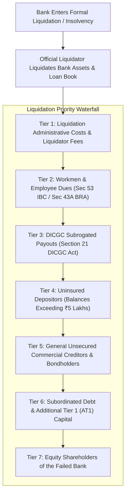

When a borrower defaults on a home loan, personal loan, or business overdraft, they frequently express shock when their bank unilaterally freezes and debits funds from their personal savings or fixed deposit accounts without a prior court decree.

This executive power is known as the **Banker's General Lien and Right of Set-Off**, established under **Section 171 of the Indian Contract Act, 1872** and codified in central banking jurisprudence. Furthermore, when a bank itself collapses into insolvency, the statutory interaction between set-off, DICGC subrogation, and the **Depositor Priority Waterfall** determines whether uninsured cash can ever be recovered.

## 1. The Legal Doctrine of Set-Off

The **Right of Set-Off** is the statutory right of a debtor (in this case, the bank) to reduce the amount of its debt by the amount of any counter-claim it has against the creditor (the depositor).

Under **Section 171 of the Indian Contract Act, 1872**:
> *"Bankers may, in the absence of a contract to the contrary, retain as a security for a general balance of account, any goods bailed to them."*

### Three Essential Conditions for Exercising Set-Off:
1. **Mutuality of Parties:** The debts must be between the exact same parties. The bank cannot adjust a loan owed by a corporate entity against the personal savings of a shareholder or director, unless a personal guarantee was executed.
2. **Same Right and Capacity:** A debt due from a customer in their personal capacity cannot be set off against a trust account or partnership account where they act merely as a trustee or partner.
3. **Ascertainable & Due Debt:** The debt owed to the bank must be a legally enforceable, matured debt (e.g. an EMI in default or an overdraft expired). A bank cannot set off against a loan that is performing normally with zero arrears.

## 2. Set-Off During Bank Liquidation: Section 17 of DICGC Act

When a bank fails, the DICGC does not insure gross deposits. Under **Section 17(1)** of the DICGC Act:
> *"The Corporation shall determine the liability... by deducting any amount due by the depositor to the insured bank in the same capacity and right."*

### Quantitative Analysis of the Aggregation Equation:

$$\text{Gross Assets} = \text{Savings} + \text{Fixed Deposits} + \text{Accrued Interest}$$

$$\text{Net Insured Claim} = \min\Big(₹5,00,000, \max\big(0, \text{Gross Assets} - \text{Matured Liabilities}\big)\Big)$$

If an individual holds ₹8,00,000 in an FD and owes ₹2,00,000 on a car loan at the same failed bank:
- Net claim after set-off: $₹8,00,000 - ₹2,00,000 = \mathbf{₹6,00,000}$
- DICGC pays the statutory maximum cap: **₹5,00,000**
- Remaining unprotected claim: **₹1,00,000**

## 3. The Depositor Priority Waterfall in Bank Liquidation

For amounts exceeding the ₹5,00,000 DICGC insurance ceiling, depositors must participate in the insolvency distribution administered by the Official Liquidator appointed by the High Court under the **Banking Regulation Act, 1949**:

### Hierarchy of Asset Distribution:
1. **Liquidation Costs:** Court administration, liquidator fees, and asset auction costs are paid first.
2. **Workmen's Dues:** Wages and statutory provident fund dues of bank employees for the preceding 24 months.
3. **DICGC Reimbursement (Section 21 Priority):** Once the liquidator realizes cash from auctioning the bank's branches, IT systems, and loan recoveries, **Section 21 of the DICGC Act mandates that DICGC must be reimbursed first** for the ₹5,00,000 per depositor it previously disbursed!
4. **Uninsured Depositors:** Only after DICGC is fully reimbursed does the liquidator release pro-rata dividend payments to depositors whose balances exceeded ₹5,00,000.
5. **Subordinated Creditors & Shareholders:** Holders of Additional Tier-1 (AT1) bonds (as seen in the Yes Bank restructuring) and common equity shareholders rank at the bottom of the waterfall and are routinely written down to zero.

## 4. Strategic Hedging Rules for Large Depositors

1. **Avoid Pairing Large Loans with Large Deposits in the Same Bank:** If you maintain a ₹25 Lakh mortgage and ₹10 Lakh in fixed deposits at the same institution, a dispute or freeze creates automatic set-off entanglements.
2. **Partition Capacities Formally:** If managing SME cash flows, ensure business credit lines are registered strictly under Corporate / Private Limited PANs rather than personal individual accounts to prevent cross-account debit liens.
3. **Maintain Cash in D-SIBs:** For balances structurally exceeding the ₹5 Lakh statutory threshold, maintain accounts exclusively in SBI, HDFC Bank, or ICICI Bank, where systemic liquidation risk is mitigated by central bank intervention.
