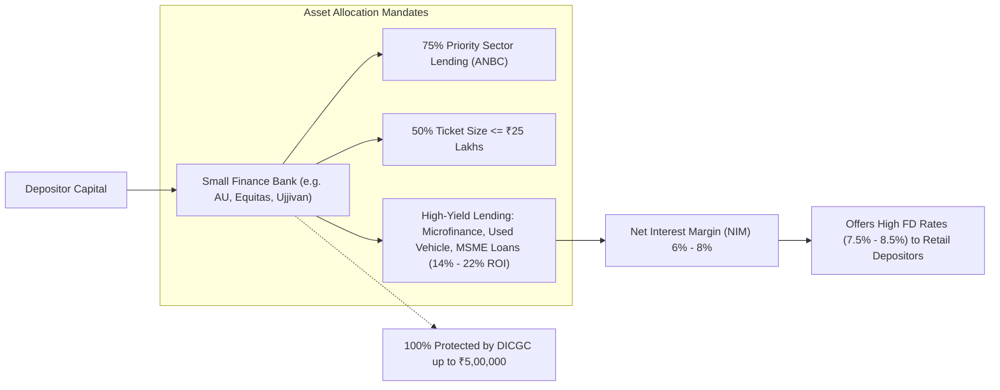

Small Finance Banks (SFBs) represent one of the most successful regulatory innovations introduced by the Reserve Bank of India in the post-2014 era. In pursuit of higher yields, Indian retail depositors and fixed-income investors have increasingly allocated capital to SFBs, which frequently quote fixed deposit rates **100 to 200 basis points higher** than traditional public sector banks or large private sector peers.

However, extracting higher yields without understanding the underlying asset-side credit risk and regulatory boundaries is an incomplete financial strategy.

## 1. Why Do SFBs Offer Higher Fixed Deposit Rates?

The ability of Small Finance Banks to pay 7.5% to 8.5% on term deposits when State Bank of India is offering 6.5% is rooted in their **Net Interest Margin (NIM)** dynamics:

1. **High-Yield Asset Portfolios:** Traditional commercial banks lend primarily to large AAA/AA corporates, salaried home buyers, and prime retail customers at interest rates ranging from 8.5% to 11.0%. In contrast, SFBs originated from Microfinance Institutions (MFIs) and Non-Banking Financial Companies (NBFCs). They lend to informal borrowers, small shopkeepers, micro-enterprises, and commercial vehicle operators at yields ranging between **15.0% and 22.0%**.
2. **Elevated NIMs:** Because their gross lending yields exceed 16%, SFBs maintain Net Interest Margins of **6.0% to 8.5%** (compared to 3.0% to 3.8% for large commercial banks). This expanded spread enables them to aggressively price liabilities (deposits) without compressing profitability.
3. **Branch Network Disadvantage:** SFBs lack the historical century-old branch networks of SBI or Bank of Baroda. To attract sticky retail deposits and reduce reliance on expensive wholesale certificates of deposit, they must offer an attractive rate premium.

## 2. Regulatory Safeguards Enforced by the RBI

To ensure that SFBs do not collapse under the weight of unsecured or concentrated lending, the central bank imposes constraints significantly stricter than those applied to universal banks:

| Regulatory Parameter | Universal Commercial Banks | Small Finance Banks (SFBs) |
| :--- | :--- | :--- |
| **Minimum Capital Adequacy (CRAR)** | 11.5% (Basel III) | **15.0%** (Higher loss-absorption cushion) |
| **Minimum Tier 1 Capital** | 7.0% | **7.5%** |
| **Priority Sector Lending (PSL)** | 40% of ANBC | **75% of ANBC** |
| **Loan Ticket-Size Restriction** | None (governed by Large Exposure Framework) | **At least 50% of loans must be $\le$ ₹25 Lakhs** |
| **Promoter Lock-in & Dilution** | Staged dilution | 40% minimum for 5 years, phased dilution |

## 3. The Credit Risk Landscape: Unsecured vs Secured Portfolios

The primary operational risk for SFB depositors is credit concentration and macroeconomic vulnerability among informal borrowers:
- **Unsecured Microfinance Exposure:** Borrowers in microfinance groups rely on daily or weekly cash flows. During natural disasters (floods, droughts), pandemics, or localized farm-loan waiver announcements, collection efficiencies can drop sharply from 99% to 85%, inflicting substantial credit loss provisions.
- **Secured Transformation:** Leading SFBs (e.g., AU Small Finance Bank) have systematically transitioned their portfolios toward secured assets—such as wheels (auto loans), affordable home loans, and MSME loans backed by property mortgages—significantly mitigating systemic default risks.

## 4. The Quantitative "SFB Laddering" Playbook

For an investor holding cash buffers, Small Finance Banks offer an exceptional risk-adjusted yield opportunity **if and only if** the portfolio is kept strictly within DICGC statutory boundaries:

$$\text{Optimal SFB Ticket Size} = ₹4,25,000 \text{ Principal}$$

### Why ₹4,25,000 instead of ₹5,00,000?
If you place ₹4,25,000 in a 3-year cumulative fixed deposit at 8.00% annual compounding:
- Year 1 Maturity Value: ₹4,59,000
- Year 2 Maturity Value: ₹4,95,720
- Year 3 Maturity Value: ₹5,35,377

If the bank were placed under regulatory freeze near maturity, the balance exceeding ₹5,00,000 (₹35,377) would be uninsured. By locking ₹4,25,000 for 2 years or ₹4,00,000 for 3 years, the total claim (principal + interest) remains **100% within the ₹5,00,000 statutory umbrella**.
