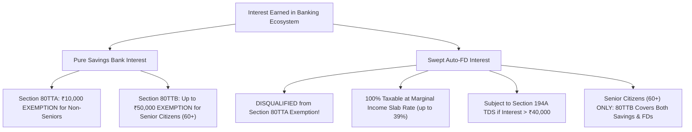

The marketing brochures of Indian commercial banks consistently advertise gross nominal interest rates: *"Earn up to 7.25% on your savings with Auto-Sweep!"* 

What these promotional materials routinely omit is the fundamental difference in tax treatment under the **Income Tax Act, 1961** between interest earned on a **savings bank balance** and interest earned on a **swept term deposit**.

For taxpayers in the 20%, 30%, or highest marginal surcharge tax brackets, this statutory asymmetry can erode a significant portion of nominal yield advantages.

## 1. Section 80TTA: The Savings Interest Tax Shelter

Under **Section 80TTA** of the Income Tax Act, 1961:
- An Individual or Hindu Undivided Family (HUF) below 60 years of age is entitled to a deduction of up to **₹10,000 per financial year** on interest income derived from **savings accounts** with a banking company, cooperative society engaged in banking, or post office.
- Crucially, the statutory language of Section 80TTA(2) **explicitly excludes** interest from **time deposits** (fixed deposits, recurring deposits, or flexi-sweep term deposits).

### The Tax Arbitrage Conundrum:
If a retail taxpayer earns ₹9,500 in annual interest from a standard savings bank account, the entire ₹9,500 is 100% tax-free under Section 80TTA. The post-tax yield equals the pre-tax yield.

However, if that same individual activates auto-sweep and earns ₹14,000 in interest—composed of ₹2,000 from the retained savings threshold and ₹12,000 from swept FDs:
- The ₹2,000 savings portion is exempt under Section 80TTA.
- The ₹12,000 swept FD portion is **fully taxable** under *Income from Other Sources* at the taxpayer's applicable marginal tax rate!

## 2. Quantitative Post-Tax Yield Comparison

Consider an individual in the **31.2% tax bracket** (30% slab + 4% health & education cess) evaluating where to hold ₹3,00,000 of liquid operating cash:

### Scenario A: Pure High-Yield Savings Account (at 3.50% p.a.)
- Gross Interest Earned: $₹3,00,000 \times 3.50\% = \mathbf{₹10,500}$
- Section 80TTA Exemption: ₹10,000
- Taxable Interest: $₹10,500 - ₹10,000 = ₹500$
- Tax Paid at 31.2%: $₹500 \times 31.2\% = \mathbf{₹156}$
- **Net In-Pocket Interest:** $₹10,500 - ₹156 = \mathbf{₹10,344}$
- **Effective Net Yield:** **3.45%**

### Scenario B: Auto-Sweep Account (Threshold ₹25k, FD at 7.00% p.a.)
- Retained Savings Part: ₹25,000 @ 3.00% = ₹750
- Swept FD Part: ₹2,75,000 @ 7.00% = ₹19,250
- Total Gross Interest: $₹750 + ₹19,250 = \mathbf{₹20,000}$
- Section 80TTA Exemption on Savings: ₹750 (Unused 80TTA limit: ₹9,250 lost!)
- Taxable Swept FD Interest: ₹19,250
- Tax Paid at 31.2%: $₹19,250 \times 31.2\% = \mathbf{₹6,006}$
- **Net In-Pocket Interest:** $₹20,000 - ₹6,006 = \mathbf{₹13,994}$
- **Effective Net Yield:** **4.66%**

### The Net Takeaway:
While gross nominal yield surged from 3.50% to nearly 7.00% (+350 bps), the **net post-tax alpha** after accounting for the loss of 80TTA tax shelters is only **1.21 percentage points** (₹3,650 annually). If unexpected cash drawdowns cause premature FD breakage penalties (0.50%–1.00%), that net spread compresses even further.

## 3. Section 80TTB: The Senior Citizen Game Changer

For resident senior citizens (aged 60 years or above), Parliament introduced **Section 80TTB** with effect from AY 2019–20:
- Allows a deduction of up to **₹50,000 per financial year**.
- Unlike Section 80TTA, Section 80TTB covers interest from **both savings accounts AND fixed/term deposits**.

> [!IMPORTANT]
> **Senior Citizens Benefit Most from Auto-Sweep:** For an individual aged 60+, the entire ₹20,000 interest in Scenario B is shielded by Section 80TTB, resulting in ₹0 tax and a full 6.67% post-tax yield.

## 4. TDS Implications under Section 194A

Under **Section 194A** of the Income Tax Act:
- Banks must deduct Tax Deducted at Source (TDS) at **10%** if total interest from fixed deposits across all branches of the bank exceeds **₹40,000** in a financial year (or **₹50,000** for senior citizens).
- Savings account interest is **never subject to TDS** under Section 194A.
- Swept FDs, however, count toward the ₹40,000 TDS threshold. Once crossed, the bank automatically withholds tax, forcing the depositor to track Form 26AS/AIS and claim credit or file Form 15G/15H.
