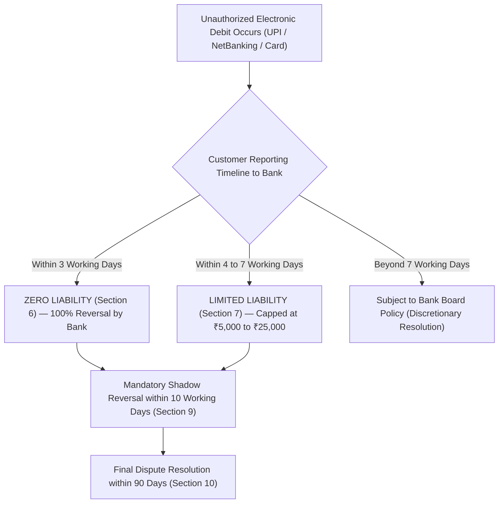

With the exponential surge in Unified Payments Interface (UPI) volumes, immediate payment services (IMPS), and internet banking, digital fraud has become the primary operational hazard confronting Indian bank depositors. From SIM-swap scams and fraudulent APK screen-mirroring apps to sophisticated phishing portals, unauthorized debits can drain personal or business reserves within seconds.

Recognizing the asymmetry of technological capability between retail customers and institutional banks, the Reserve Bank of India issued a landmark binding regulatory circular: **DBR.No.Leg.BC.78/09.07.005/2017-18 on Limiting Liability of Customers in Unauthorised Electronic Banking Transactions**.

## 1. The Three Tiers of Customer Liability

The RBI circular categorizes liability into three distinct statutory regimes based strictly on **reporting latency** and **negligence attribution**:

### Regime 1: Zero Liability (100% Reversal)
A customer is entitled to **Zero Liability** under two explicit statutory conditions:
1. **Contributory Fraud / System Failure:** Where the unauthorized transaction is due to contributory fraud, negligence, or deficiency on the part of the bank (irrespective of whether or not the transaction is reported by the customer).
2. **Third-Party Breach with Prompt Reporting:** Where a third-party breach lies neither with the bank nor with the customer (e.g. database leak, skimming, man-in-the-middle attack) and the customer notifies the bank **within 3 working days** of receiving the transaction SMS/email alert from the bank.

### Regime 2: Limited Liability (4 to 7 Working Days)
Where the responsibility for the unauthorized transaction lies neither with the customer nor with the bank, but lies elsewhere in the system, and the customer reports the transaction within **4 to 7 working days**, the maximum liability of the customer is strictly capped by the RBI:

| Account Type / Credit Limit | Maximum Customer Liability Cap |
| :--- | :--- |
| Basic Savings Bank Deposit (BSBD) / Small Accounts | **₹1,00,000 balance: Max ₹1,000** |
| All other Savings Accounts, Pre-paid Instruments, Credit Cards with limit up to ₹5 Lakhs | **Max ₹5,000** |
| All other Current / Cash Credit / Overdraft Accounts, Credit Cards with limit > ₹5 Lakhs | **Max ₹10,000** |

Even if a fraudster drains ₹15,00,000 from a corporate overdraft account via a third-party hack, reporting within 7 working days caps the customer's maximum loss at **₹10,000**, with the bank mandated to absorb or recover the remaining ₹14,90,000.

### Regime 3: Customer Negligence (Sharing OTP / PIN)
Where the loss is due to customer negligence—specifically where the customer has **voluntarily shared payment credentials** (such as revealing the OTP, password, or ATM PIN to a scammer)—the customer will bear the entire loss **until** they report the unauthorized transaction to the bank. Any loss occurring *after* reporting the fraud must be borne entirely by the bank.

## 2. Reversal Timelines: The 10-Day Shadow Credit Mandate

Under **Section 9** of the RBI circular:
- Once a customer reports an unauthorized electronic transaction, the bank is statutorily required to credit the amount involved back into the customer’s account within **10 working days** from the date of intimation (known as a "Shadow Credit" or provisional reversal).
- The bank may not wait for police investigations, cyber cell charge-sheet filings, or internal forensic completion before issuing this 10-day provisional credit.
- The complaint must be resolved and liability definitively determined within a maximum of **90 days** from the receipt of the complaint.

## 3. Statutory Burden of Proof: Rest on the Bank

Under **Section 12** of the Master Circular:
> *"The burden of proving customer negligence in unauthorized electronic banking transactions shall lie entirely on the bank."*

A bank cannot dismiss a claim simply by stating that "the transaction was completed with correct 2-factor authentication." If the customer asserts that the SMS was intercepted or malware compromised the device without their consent, the bank must provide forensic proof that the customer voluntarily shared credentials.

## 4. Immediate Fraud Response Protocol

1. **Immediate Block & Freeze:** Call the bank’s 24x7 emergency helpline or use mobile banking to freeze UPI handles, debit cards, and net-banking access immediately.
2. **Written Intimation & Token Number:** Dispatch an email from your registered email address to the bank's Nodal Officer and Cyber Grievance cell, recording the exact transaction reference numbers (UTR, RRN) and obtaining a ticket number.
3. **National Cyber Crime Portal (1930):** File an immediate report on the Government of India portal `cybercrime.gov.in` or dial the national helpline **1930** to freeze the scammer's beneficiary mule account before funds are laundered.
