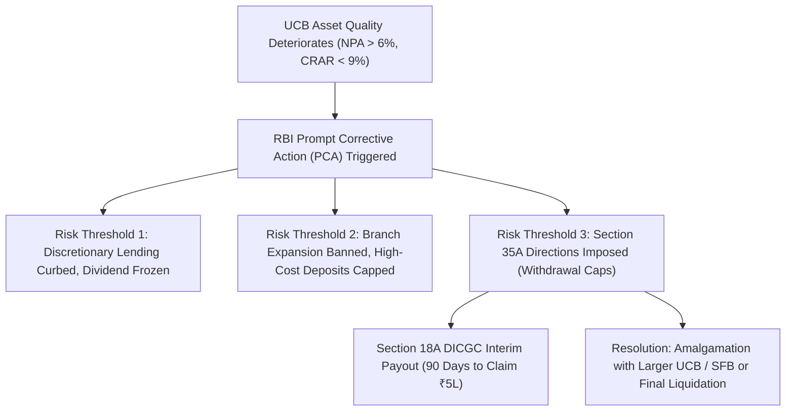

Urban Cooperative Banks (UCBs) occupy a storied position in India's financial landscape, founded on cooperative principles of mutual self-help, local credit access, and community mobilization. However, across the past three decades, cooperative banks have accounted for **over 90% of all bank failures and DICGC liquidation claims** in India.

For depositors, understanding the institutional architecture and supervisory thresholds governing UCBs is critical before placing operating balances in pursuit of an extra 50 to 100 basis points in term deposit interest.

## 1. The Anatomy of UCB Vulnerability

Why have cooperative banks historically exhibited higher failure rates than scheduled commercial banks?

1. **Borrower-Owner Conflict of Interest:** In a commercial bank, shareholders seek equity returns while borrowers seek credit. In a cooperative bank, borrowers are frequently voting members of the cooperative society. This structural convergence often created political lending networks, where management approved under-collateralized loans to related directors or dominant local political figures.
2. **Delayed Regulatory Enforcement under Dual Control:** Prior to the 2020 legislative amendments, if the RBI detected fraud in a cooperative bank, it had to recommend supersession to the State Registrar of Cooperative Societies, introducing bureaucratic and political delays that allowed capital depletion to accelerate.
3. **Concentration Risk:** UCBs frequently lack geographic diversification. A drought, localized real estate downturn, or regional industrial closure in a single district can impair 30% of a small UCB's loan book simultaneously.

## 2. The 2020 Banking Regulation Overhaul

In the aftermath of the Punjab and Maharashtra Cooperative (PMC) Bank failure in September 2019—where over 70% of the bank's total advances were concentrated in a single defaulting real estate borrower (HDIL) hidden behind thousands of dummy accounts—Parliament enacted the **Banking Regulation (Amendment) Act, 2020**.

### Core Regulatory Shifts:
- **Direct Supersession Powers:** The RBI can now directly remove corrupt or incompetent boards and appoint an Administrator without waiting for state political concurrence.
- **Auditor Approval:** Statutory auditors of UCBs must now be approved by the RBI, aligning reporting standards with commercial banking audits.
- **Capital Raising Flexibility:** Cooperative banks were granted powers to issue equity shares, preference shares, and unsecured debentures with prior RBI clearance.

## 3. The RBI Prompt Corrective Action (PCA) Framework for UCBs

The RBI enforces a strict Prompt Corrective Action (PCA) framework for Tier 2, Tier 3, and Tier 4 UCBs based on financial trigger points:

| Indicator | Risk Threshold 1 | Risk Threshold 2 | Risk Threshold 3 |
| :--- | :--- | :--- | :--- |
| **Capital Adequacy (CRAR)** | Falls below 9% (or required minimum) by up to 250 bps | Falls below minimum by 250 bps to 400 bps | Falls below minimum by > 400 bps |
| **Net Non-Performing Assets (NNPA)** | Exceeds 6.0% but $\le$ 9.0% | Exceeds 9.0% but $\le$ 12.0% | Exceeds 12.0% |
| **Profitability (ROA)** | Negative for 2 consecutive years | Negative for 3 consecutive years | Negative for 4 consecutive years |

### Enforcement Sanctions:
- **At Threshold 1:** Mandatory capital restoration plan; restriction on dividend distribution and profit repatriation.
- **At Threshold 2:** Total prohibition on opening new branches; restrictions on accepting high-interest fixed deposits; curbs on capital expenditure.
- **At Threshold 3:** Prohibition on expanding risk-weighted assets; mandatory reduction in credit exposures; imposition of Section 35A directions capping cash withdrawals.

## 4. Prudent Cash Rules for Cooperative Bank Depositors

1. **Strictly Cap Balances at ₹4,50,000:** Because accrued interest is clubbed with principal under DICGC rules, never park more than ₹4.5 Lakhs in principal in any single cooperative bank. This ensures that accrued interest never breaches the statutory ₹5 Lakh boundary.
2. **Verify Tier Classification:** Determine whether the UCB is Tier 1, 2, 3, or 4. Prefer Tier 3/4 institutions with deposits exceeding ₹1,000 Crore, as they operate under more rigorous digital and audit surveillance.
3. **Inspect the Latest Audit Balance Sheet:** Before locking an FD, verify the bank's Capital to Risk-Weighted Assets Ratio (CRAR) and Net NPA ratio from its published annual report. If Net NPA exceeds 5% or CRAR is hovering near 9%, do not deposit unsecured funds.
